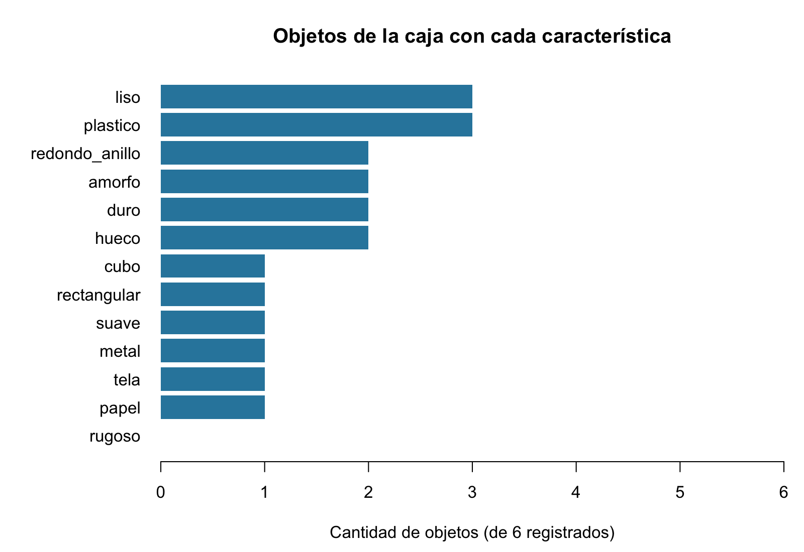
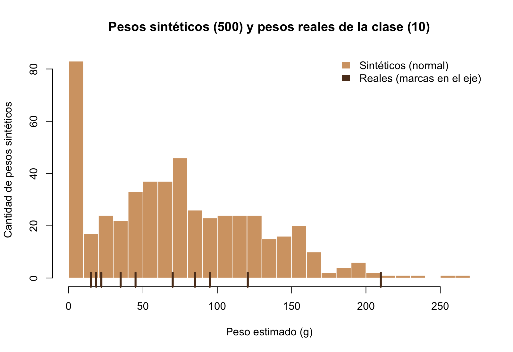

# Clase 2 — La caja negra

## Qué se hizo en clase

Había una caja cerrada con objetos adentro. Cada uno metía la mano, tocaba un objeto sin verlo y anotaba lo que percibía: forma, textura, material.

Con eso armamos una tabla: una fila por objeto y una columna por característica, marcando con 1 lo que el objeto tenía.

La idea de la clase es que los datos no existen solos: salen de un proceso que los genera (la caja) y de una forma de medir (la mano, sin ver, en pocos segundos). Si la medición es mala, la tabla también.

## Qué hay en esta carpeta

| Archivo | Qué es |
|---|---|
| `objetos_caracteristicas.xlsx` | La tabla que armé en clase. Tiene 6 objetos registrados; las filas 7 a 11 quedaron sin completar. |
| `caja.R` | El script. Lee la tabla, la revisa, le da tipo a cada variable y repite los dos métodos de la clase para generar más datos. |
| `caja_caracteristicas.png` | Cuántos objetos tienen cada característica. |
| `caja_pesos_sinteticos.png` | Pesos generados con una normal, comparados con los pesos reales del ejemplo de la clase. |

Para correrlo: abrir `caja.R` en RStudio, elegir *Session > Set Working Directory > To Source File Location* y apretar *Source*. Solo necesita el paquete `readxl`.

## Resultados

**Mi tabla (parte A)**

- 6 objetos registrados: cubo rubik, peluche, tuerca, cuaderno o libreta, juguete de bebé con forma de anillo y varias cosas de plástico.
- Las características más repetidas son liso y plástico, con 3 objetos cada una.
- Ningún objeto quedó marcado como rugoso.
- 4 objetos son rígidos y 2 flexibles.

**El ejemplo de la clase (parte B)**

Mi tabla no tiene ninguna variable numérica continua, así que para esta parte usé los 10 objetos de ejemplo de la clase, que tienen peso estimado.

- **Bootstrap.** Saqué 100 filas con reposición. Son 100 filas, pero siguen siendo los mismos 10 objetos repetidos (entre 6 y 13 veces cada uno). El peso medio pasó de 71,6 g a 82,4 g solo por cuáles objetos salieron más veces.
- **Generación paramétrica.** Generé 500 pesos con una normal de media 71,6 g y desvío 60,4 g. De esos 500, 60 dieron cero o negativos, que es imposible para un peso. Al llevarlos a 1 g quedan todos amontonados en la primera barra del gráfico.

## Qué falló

1. **La lectura directa del Excel leyó 13 filas en vez de 11.** Debajo de la tabla hay una nota ("Marcar con 1 la característica que corresponda..."). R la tomó como una fila más y, como es texto, convirtió la columna `objeto` de número a texto. No dio ningún error. Lo resolví leyendo solo el rango de la tabla (`A1:P12`).
2. **La columna `rugoso` se leyó como lógica y no como número**, porque está toda vacía y R no tiene de dónde sacar el tipo.
3. **La normal generó 60 pesos imposibles.** El desvío es casi tan grande como la media, así que una parte de la campana cae por debajo de cero.

## Decisiones

| Decisión | Alternativa descartada | Por qué |
|---|---|---|
| Sacar las filas 7 a 11. | Dejarlas con todo en FALSE. | No son objetos sin características: son objetos que no se registraron. |
| Tomar la celda vacía como "no tiene la característica". | Dejarla como faltante. | En clase la consigna fue marcar con 1 lo que el objeto tenía. |
| Declarar `rigidez` como ordinal (flexible < rígido). | Dejarla como texto. | Sin declarar el orden, R la ordena alfabéticamente. |

**Límite de la segunda decisión.** La planilla no distingue "no lo tiene" de "no lo anoté". El objeto 6 ("varias cosas de plástico") solo tiene marcado plástico, y lo más probable es que el resto no se haya registrado. Además, no es un objeto sino varios en una misma fila.

## Lo que me llevo

- La tabla depende de quién midió y cómo. "Liso" o "duro" son lo que alguien sintió en unos segundos, no una propiedad medida con un instrumento.
- Tener más filas no es tener más información. El bootstrap repite lo que ya hay y la normal inventa valores que en la caja no existen.
- Un archivo puede leerse mal sin avisar. Hay que mirar cuántas filas entraron y de qué tipo quedó cada columna antes de seguir.

## Fechas y uso de IA

- La tabla es del 18/08. El script y este texto son del 13/11: en su momento no llevé la bitácora al día.
- El script lo armé con ayuda de un asistente de IA (Claude). Lo corrí yo en RStudio y verifiqué que los números del bloque de control coincidieran con los de este texto.
