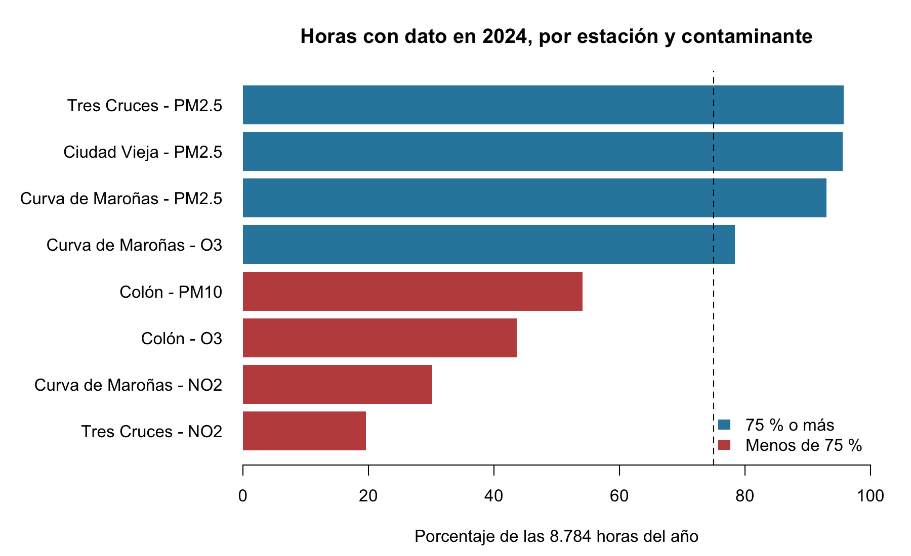
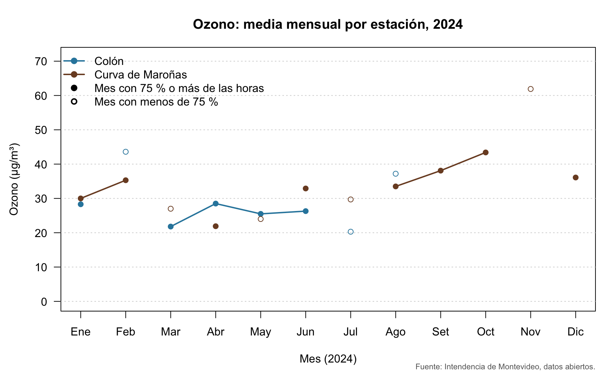

# Clase 7 — Carga de datos con rutas

## De qué trata

La clase toma datos de calidad del aire de Montevideo y recorre el camino completo: cargar el archivo con rutas que funcionen en cualquier máquina, perfilarlo, corregir los tipos, crear variables nuevas y generar información agregada por mes.

## Qué datos usé

En clase se trabajó con tres archivos (ozono, PM2,5 y conteo vehicular) que no tengo. Hice el mismo recorrido con el archivo público de la misma fuente.

| | |
|---|---|
| **Fuente** | Intendencia de Montevideo, Portal de Datos Abiertos |
| **Conjunto** | Red de monitoreo de la calidad del aire de Montevideo |
| **Recurso** | Medidas de la calidad del aire - 2024 (`automaticas_24.csv`) |
| **Página** | https://ckan.montevideo.gub.uy/dataset/red-de-monitoreo-de-la-calidad-del-aire-de-montevideo |
| **Descargado el** | 13/11/2026 |
| **Licencia** | dag-uy, según indica el portal |
| **Tamaño** | 6,6 MB, 70.272 filas y 10 columnas |

El archivo no está en el repositorio. El script lo descarga solo la primera vez que corre.

## Qué hay en esta carpeta

| Archivo | Qué es |
|---|---|
| `carga_aire.R` | El script: rutas, descarga, carga, perfilado, limpieza, variables nuevas y ozono por mes. |
| `aire_cobertura.png` | Porcentaje de horas con dato en cada estación y contaminante. |
| `aire_ozono_mensual.png` | Ozono medio por mes en las dos estaciones que lo miden. |
| `salida_carga_aire.txt` | Lo que respondió el script en mi máquina. |

Para correrlo: abrir `carga_aire.R` en RStudio, *Session > Set Working Directory > To Source File Location* y *Source*. Necesita el paquete `here`.

## Las rutas

El script no tiene ningún `setwd()` ni ninguna ruta escrita con mi nombre de usuario. Usa el paquete `here`, que busca la raíz del proyecto y arma las rutas desde ahí:

```r
here::i_am("clase07_carga_y_rutas/carga_aire.R")
RUTA_DATOS <- here("clase07_carga_y_rutas", "datos", "automaticas_24.csv")
```

Así corre igual en mi máquina y en la de quien clone el repositorio.

## Perfilado

Cada fila es un contaminante, en una estación, en una hora.

| Chequeo | Qué encontré |
|---|---|
| Estructura | 4 estaciones, 4 contaminantes y 8 series en total, porque no todas las estaciones miden lo mismo. |
| Grilla | Completa: cada serie tiene las 8.784 horas de 2024 (366 días por 24). |
| Identificador | Contaminante + estación + hora. No hay ninguna combinación repetida ni filas duplicadas. |
| Columnas que no distinguen nada | El período de promedio (siempre 1 hora) y la unidad (siempre µg/m³). |
| Faltantes | Solo en el valor medido: 25.455 celdas vacías, el 36,2 % del archivo. |

Qué mide cada estación:

| Estación | NO2 | O3 | PM10 | PM2,5 |
|---|:-:|:-:|:-:|:-:|
| Ciudad Vieja | | | | sí |
| Colón | | sí | sí | |
| Curva de Maroñas | sí | sí | | sí |
| Tres Cruces | sí | | | sí |

## Cobertura

Que la grilla esté completa no quiere decir que haya datos: las horas están todas, pero muchas vienen vacías.



- El PM2,5 tiene entre 93 % y 96 % de las horas en las tres estaciones que lo miden.
- El NO2 es el peor: 30,2 % en Curva de Maroñas y 19,6 % en Tres Cruces.
- Cuatro de las ocho series tienen menos del 75 % de las horas.

## Ozono por mes



Marqué como confiables solo los meses con 75 % o más de las horas: 13 de 24.

- **Colón no tiene ningún dato de ozono de setiembre a diciembre.** En febrero tiene 28 horas de 696.
- **El mes más alto del año no es confiable.** Noviembre en Curva de Maroñas da 61,9 µg/m³, pero sale de 141 horas sobre 720 (19,6 %).
- Con los meses confiables, el ozono en Curva de Maroñas va de 21,9 µg/m³ en abril a 43,4 en octubre.

Si hubiera graficado todos los promedios sin mirar cuántas horas tenían detrás, el gráfico mostraría un pico en noviembre que no se puede sostener.

## Qué falló

1. **El nombre de una estación no coincide entre dos tablas del mismo conjunto.** El archivo de medidas dice "Ciudad Vieja2", sin espacio; la tabla de estaciones dice "Ciudad Vieja 2". Una unión por nombre dejaría afuera esa estación sin avisar. Lo corregí en el script.
2. **El archivo llama "PM2" al PM2,5.** En la tabla de contaminantes del mismo conjunto figura como "material particulado menor de 2.5 micras".
3. **La fecha llega como texto.** Hay que convertirla para poder sacar el mes y la hora. No hubo fechas que fallaran al convertir.
4. **Mayo en Curva de Maroñas queda justo debajo del umbral.** Tiene 74,7 % de las horas. Si se redondea antes de comparar pasa como confiable; el script compara el valor sin redondear.

## Decisiones

| Decisión | Alternativa descartada | Por qué |
|---|---|---|
| Usar el archivo público de 2024. | Esperar a conseguir los archivos de la clase. | Es la misma fuente, y el origen queda documentado. Las columnas no son las mismas que en clase. |
| No subir el CSV; el script lo descarga. | Subir el archivo al repositorio. | Es la regla del curso: se versiona el código que obtiene el dato, no el dato. |
| Umbral de 75 % de horas para dar por bueno un mes. | Promediar lo que haya. | Un promedio de pocas horas no representa al mes. El 75 % es un criterio mío. |
| No rellenar los faltantes. | Imputar con el promedio. | Hay series con meses enteros sin dato; rellenarlos sería inventar. |
| Tomar la hora tal como viene. | Convertir de zona horaria. | El archivo no dice en qué zona horaria está. |

## Lo que me llevo

- Antes de promediar hay que contar. El número que acompaña a cada promedio (cuántas horas tiene detrás) dice si se puede usar.
- Hay dos formas de que falte un dato: que la fila no exista o que exista vacía. Acá las filas están todas y lo que falta es el valor.
- Bajar el dato con código y anotar de dónde salió lleva dos minutos, y evita lo que me pasó con el CSV de playas.

---

Uso de IA: trabajé con un asistente (Claude) para el código y la redacción. Corrí todo en mi máquina.
