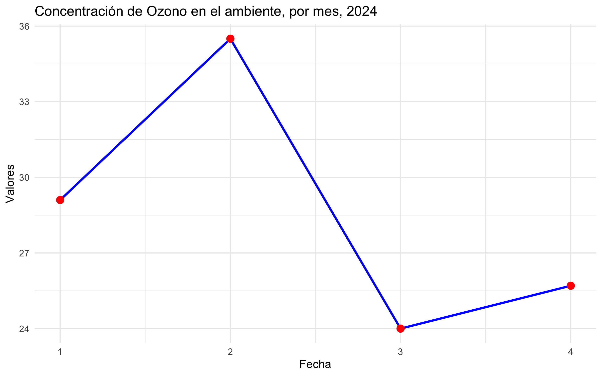
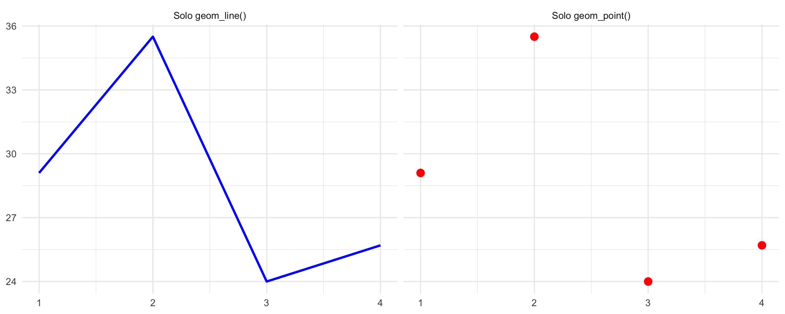
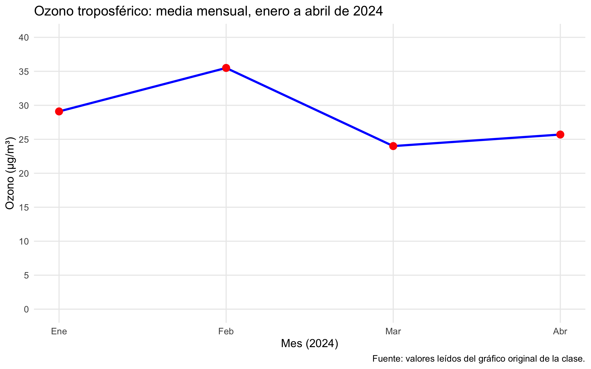
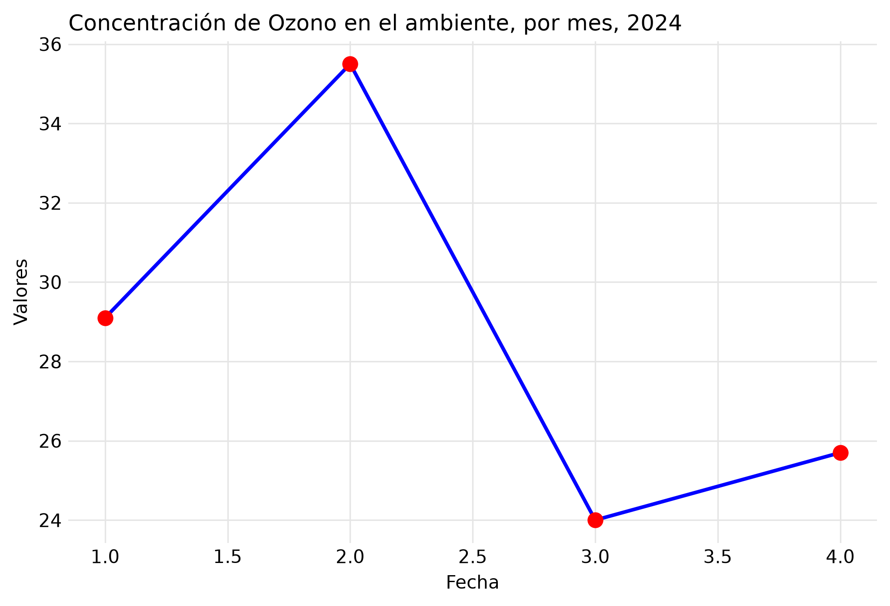
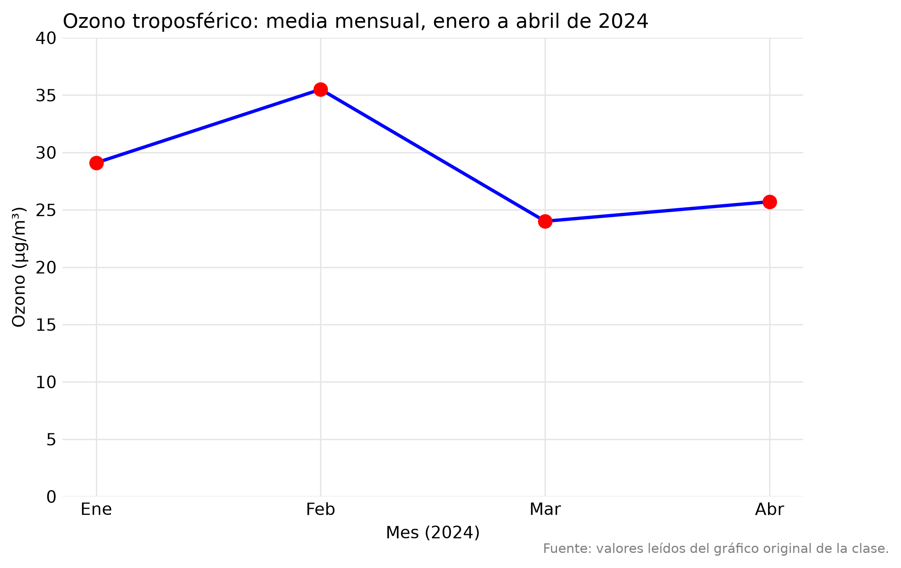
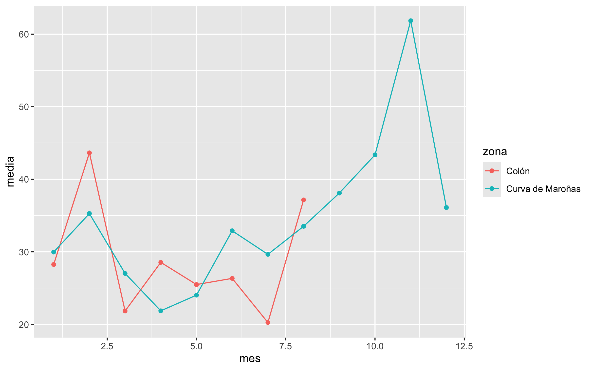
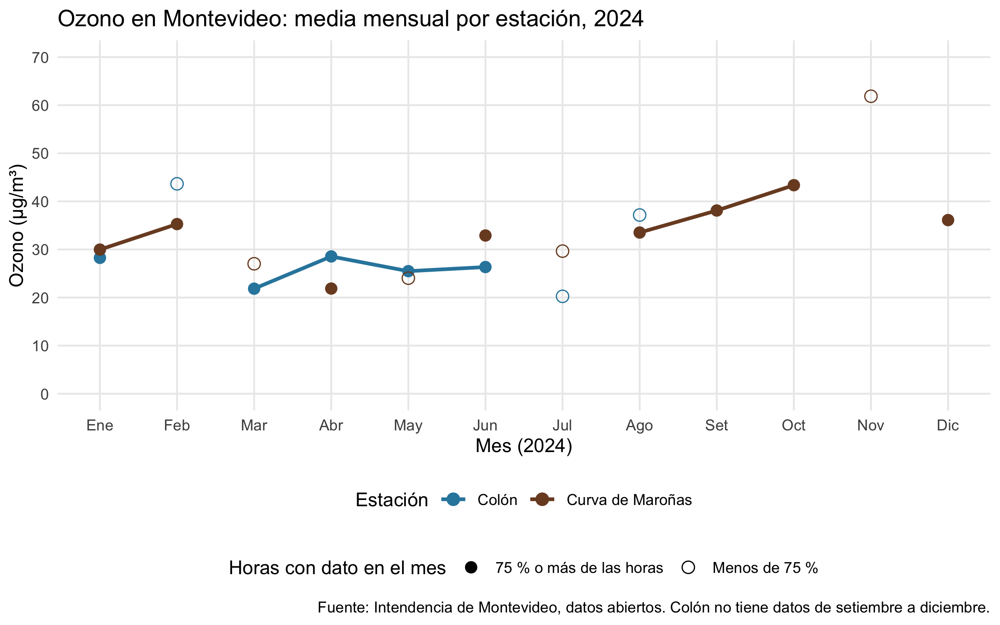

# Clases 8 y 9 — Imagen: las partes de un gráfico

## De qué tratan

Un gráfico se arma con partes, y cada una se decide por separado: los datos, cómo se dibujan, qué dicen los ejes, el título y la fuente. Las clases parten de un gráfico con problemas y lo corrigen parte por parte, en Python (matplotlib) y en R (ggplot2).

## Qué hay en esta carpeta

| Archivo | Qué es |
|---|---|
| `partes_de_un_grafico.py` | Las tres figuras del teórico, en Python. |
| `partes_de_un_grafico.R` | Las mismas tres figuras, en R. |
| `grafico_propio.R` | El mismo recorrido con mis datos de ozono de la clase 7. |
| `imagenes_python/` | Las tres figuras hechas con matplotlib. |
| `imagenes_r/` | Las tres figuras hechas con ggplot2 y las dos del gráfico propio. |

`grafico_propio.R` usa el archivo de datos de la clase 7. Si no está descargado, hay que correr antes `clase07_carga_y_rutas/carga_aire.R`.

## Las partes de un gráfico

| Parte | Qué decide | En ggplot2 | En matplotlib |
|---|---|---|---|
| Datos y mapeo | Qué columna va a qué eje o a qué color. | `ggplot(datos, aes(...))` | Los argumentos de `ax.plot()` |
| Geometría | Cómo se dibuja: línea, puntos, cajas. | `geom_line()`, `geom_point()` | `ax.plot()`, `ax.scatter()` |
| Atributos fijos | Color y grosor que no representan ningún dato. | `color =` fuera de `aes()` | `color=`, `linewidth=` |
| Título y etiquetas | Qué se mide, dónde, cuándo y en qué unidad. | `labs()` | `set_title()`, `set_xlabel()` |
| Marcas y rango | Dónde van las marcas del eje y desde dónde arranca. | `scale_x_continuous()` | `set_xticks()`, `set_ylim()` |
| Grilla y bordes | Todo lo que no son datos. | `theme_minimal()`, `theme()` | `ax.grid()`, `ax.spines` |
| Pie | La fuente y las aclaraciones. | `labs(caption = ...)` | `fig.text()` |
| Guardado | El archivo de salida. | `ggsave()` | `fig.savefig()` |

---

## Parte 1 — Las figuras de la clase

Datos de la clase: ozono medio mensual, enero a abril de 2024. Una serie, cuatro valores.

### El gráfico de partida

Qué tiene mal:

- **El eje horizontal no muestra meses.** La columna `mes` es un número y el gráfico la trata como una escala continua, con posiciones intermedias como 1,5 o 2,5 que no son ningún mes.
- **Las etiquetas no informan.** "Fecha" y "Valores" no dicen qué se mide ni en qué unidad.
- **El eje vertical arranca en 24.** La caída de febrero a marzo parece mucho más grande de lo que es.
- **No dice de dónde salen los datos.**

### La geometría: dos capas

La línea afirma que hay continuidad entre un mes y el siguiente. Los puntos marcan dónde hay una medición de verdad. Juntas muestran la tendencia sin esconder que los datos son cuatro.

### La versión corregida

Mismos datos y mismas geometrías. Cambian cinco cosas: las marcas del eje horizontal (meses con su nombre), el rango del vertical (desde cero), el título, las etiquetas con unidad y la fuente al pie.

### La misma figura en Python

| De partida | Corregida |
|---|---|
|  |  |

En ggplot2 el gráfico es un solo objeto al que se le suman capas con `+`. En matplotlib hay dos objetos, la figura y los ejes, y cada parte se cambia llamando a una función de los ejes.

---

## Parte 2 — Un gráfico propio

Apliqué lo mismo a la tabla de ozono mensual de la clase 7. Acá hay dos series (Colón y Curva de Maroñas), así que entra la segunda parte del teórico: un color por grupo y la leyenda.

### De partida

Es lo mínimo para que salga algo: `ggplot()` con `geom_line()` y `geom_point()`.

Lo único que hace bien es poner la estación dentro de `aes(color = ...)`: con eso ggplot dibuja una línea por estación, les asigna un color y arma la leyenda.

Lo que hace mal:

- **Une todos los meses, también los que casi no tienen datos.** El pico de noviembre en Curva de Maroñas sale de 141 horas sobre 720, y el de febrero en Colón de 28 sobre 696. La línea los presenta como si fueran igual de firmes que el resto.
- **El eje horizontal marca 2,5; 5,0; 7,5.** No son meses.
- **Las etiquetas son los nombres de las columnas:** "media", "mes", "zona".
- **No dice la unidad, el año ni la fuente.**

### Corregido

| Parte | Qué cambié | Por qué |
|---|---|---|
| Geometría: línea | Se corta en los meses con menos de 75 % de las horas. | La línea afirma continuidad; donde casi no hay datos no se puede afirmar. |
| Geometría: puntos | Punto lleno si el mes es confiable, vacío si no. | El dato no se esconde, pero se ve que tiene menos respaldo. |
| Marcas | Los doce meses, con su nombre. | Se ve de un vistazo que Colón no tiene nada de setiembre a diciembre. |
| Rango | Eje vertical de 0 a 70. | Para no exagerar las diferencias. |
| Color | Dos colores elegidos a mano. | Los mismos que usé en la clase 7. |
| Título y etiquetas | Qué, dónde y cuándo; la unidad en el eje. | "media" no decía nada. |
| Leyendas | "Estación" y "Horas con dato en el mes". | Con dos series la leyenda es obligatoria. |
| Pie | Fuente y aclaración sobre Colón. | Es donde va lo que el gráfico no puede mostrar solo. |

La diferencia entre los dos gráficos no es estética. En el primero, lo que más llama la atención es el pico de noviembre; en el segundo se ve que ese pico es un punto vacío, y que lo firme es la suba de agosto a octubre en Curva de Maroñas.

---

## Qué falló

1. **La línea que se corta genera un aviso en ggplot.** Cuando hay valores faltantes, ggplot corta la línea y avisa que sacó filas. En este caso el corte es a propósito, así que lo silencié con `na.rm = TRUE`.
2. **El fondo transparente.** `theme_minimal()` deja el fondo sin color y en algunos visores la imagen se ve negra. Por eso `ggsave()` lleva `bg = "white"`.
3. **El script de la clase usa `tidyverse` y `patchwork`.** Lo resolví solo con ggplot2: para poner las dos capas una al lado de la otra usé `facet_wrap()`, que ya viene incluido.

## Lo que me llevo

- Los valores por defecto de un gráfico son decisiones que tomó otro. Hay que revisarlas una por una.
- Una línea es una afirmación: dice que entre dos puntos pasó algo intermedio. Si no hay datos que lo respalden, hay que cortarla.
- Lo que va dentro de `aes()` sale de los datos; lo que va afuera es una decisión de quien dibuja.

---

Uso de IA: trabajé con un asistente (Claude) para el código y la redacción. Corrí todo en mi máquina.
