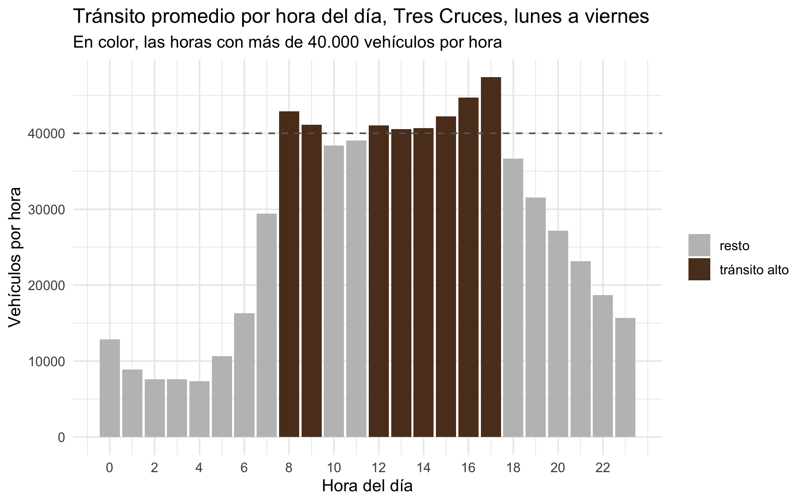
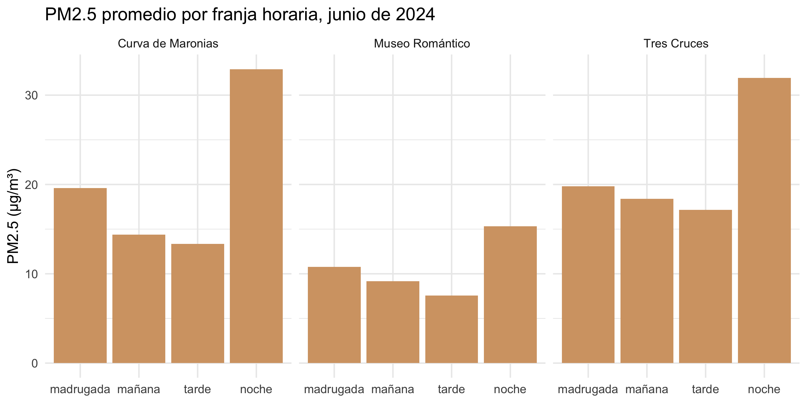
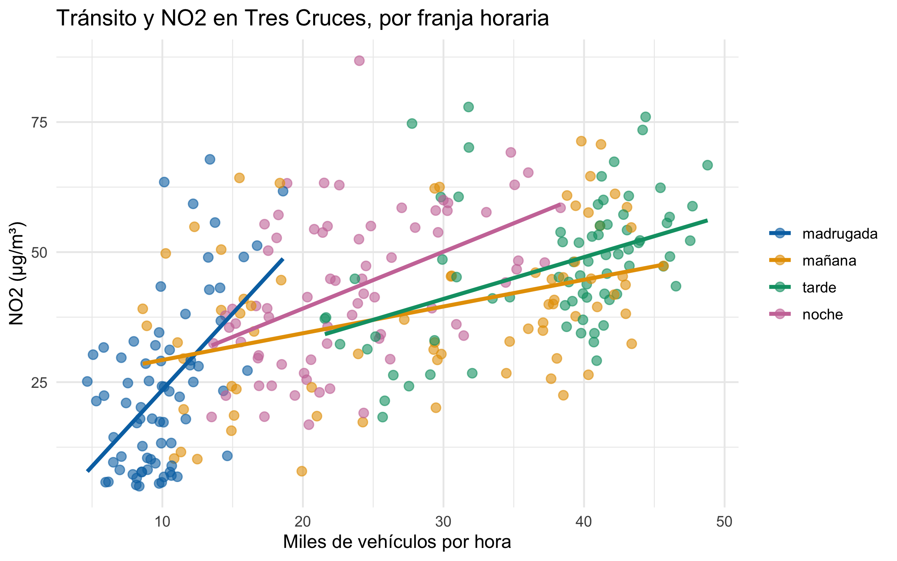
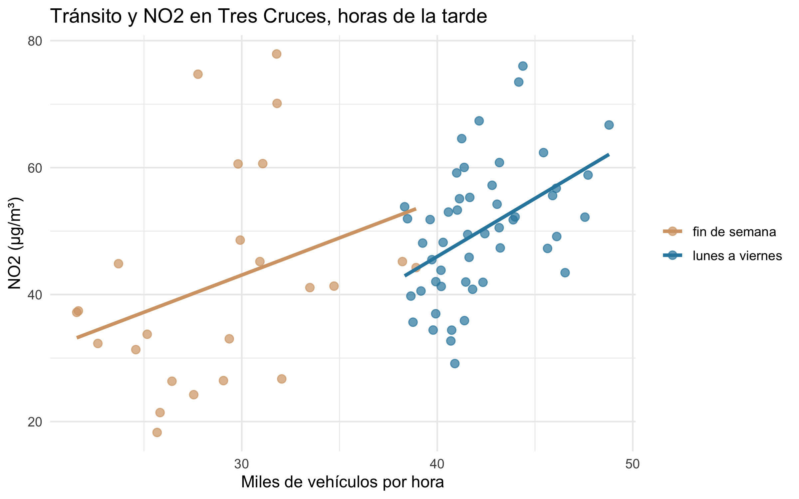

# Clase 10 — Tránsito y calidad del aire

## De qué trata

La clase trabaja sobre una tabla horaria de junio de 2024 con el tránsito y dos contaminantes (NO2 y PM2,5) medidos cerca de tres estaciones de Montevideo. La pregunta de fondo es si el tránsito se ve en la calidad del aire.

El script de la clase describe la tabla de a pasos: una variable, grupos, dos variables y un modelo lineal. Los ejercicios se apoyan en ese script.

## Qué hay en esta carpeta

| Archivo | Qué es |
|---|---|
| `transito_aire_junio2024.csv` | La tabla de la clase: una fila por estación y hora. La armó la cátedra con datos de conteo vehicular y de calidad del aire de Montevideo. |
| `analisis_transito_aire.R` | El script de análisis de la cátedra. Solo le cambié la ruta del archivo. |
| `ejercicios_transito_aire.R` | Los siete ejercicios. Las consignas son de la cátedra; la resolución es mía. |
| `imagenes/` | Las cuatro figuras que generan los ejercicios. |
| `salida_ejercicios.txt` | Lo que respondieron los dos scripts en mi máquina. |

Para correrlo: abrir `ejercicios_transito_aire.R` en RStudio, *Session > Set Working Directory > To Source File Location* y *Source*. Corre primero el análisis y después los ejercicios. Necesita `dplyr`, `readr`, `lubridate`, `ggplot2` y `here`.

## La tabla

2.160 filas y 5 columnas: 3 estaciones por 720 horas (30 días por 24).

| Columna | Qué es |
|---|---|
| `estacion` | Curva de Maroñas, Museo Romántico o Tres Cruces. |
| `hora` | Fecha y hora de la medición. |
| `transito` | Vehículos por hora, sumando los puntos de conteo a menos de 1,5 km de la estación. |
| `no2` | Dióxido de nitrógeno, promedio de la hora (µg/m³). |
| `pm25` | Material particulado fino, promedio de la hora (µg/m³). |

## Lo que muestra el script de análisis

- **El tránsito está completo; los contaminantes no.** Museo Romántico no tiene ningún dato de NO2. Tres Cruces tiene NO2 en 291 de 720 horas, todas entre el 4 y el 17 de junio.
- **El PM2,5 tiene cola larga.** En Curva de Maroñas la media es 20,1 y la mediana 11,9: unas pocas horas muy altas arrastran la media.
- **El instrumento tiene un piso.** No hay ningún valor de PM2,5 por debajo de 3: un 3 quiere decir "3 o menos".
- **En Tres Cruces el NO2 sube con el tránsito.** La recta es NO2 = 18,3 + 0,79 × tránsito (en miles de vehículos por hora), con R² = 0,35.
- **En Curva de Maroñas la misma recta no explica nada** (R² = 0,02). Tiene muy pocos puntos de conteo cerca, así que el tránsito medido representa mal al que rodea a la estación.
- **Las horas no son independientes.** El error del modelo en una hora se parece mucho al de la hora anterior (correlación 0,80). La recta sirve para describir, pero los p-valores que muestra R no son válidos acá.

---

## Ejercicios

### 1. Faltantes de la tabla con las variables nuevas

| Estación | Sin tránsito | Sin NO2 | Sin PM2,5 | Sin franja | Sin tipo de día | Sin tránsito relativo | Sin log(PM2,5) |
|---|:-:|:-:|:-:|:-:|:-:|:-:|:-:|
| Curva de Maroñas | 0 | 65 | 0 | 0 | 0 | 0 | 0 |
| Museo Romántico | 0 | 720 | 144 | 0 | 0 | 0 | 144 |
| Tres Cruces | 0 | 429 | 326 | 0 | 0 | 0 | 326 |

Las variables que salen de la hora y del tránsito no tienen faltantes, porque la hora y el tránsito están completos. `log_pm25` tiene exactamente los mismos faltantes que `pm25`: una variable derivada hereda los huecos de la variable de la que sale.

### 2. ¿Está bien definida la hora pico?

No. La hora pico estaba definida como las 7, 8, 9, 17, 18 y 19. En Tres Cruces, de lunes a viernes, las horas con más tránsito son otras.

- **Marcadas como pico y no lo son:** las 7, las 18 y las 19. A las 7 pasan 29.440 vehículos por hora, menos que a cualquier hora entre las 8 y las 19.
- **No marcadas y con más tránsito:** de las 12 a las 16.

En vez de elegir las horas a ojo, definí `transito_alto` como las horas que superan 40.000 vehículos por hora en promedio: las 8, las 9 y de las 12 a las 17. El corte sale de los datos: hay ocho horas por encima de 40.000 y la siguiente ya está en 39.000.

El tránsito en Tres Cruces no tiene dos picos sino una meseta que va de las 8 a las 17.

### 3. PM2,5 por franja horaria

En las tres estaciones el PM2,5 es máximo de noche. El tránsito es máximo de tarde. No coinciden: en Tres Cruces el PM2,5 es 31,9 de noche contra 17,2 de tarde, que es cuando más autos pasan.

### 4. Agregar la franja al modelo

| Modelo | Variables | R² |
|---|---|:-:|
| `modelo_tc3` | tránsito + PM2,5 | 0,473 |
| `modelo_tc4` | tránsito + PM2,5 + franja | 0,486 |

Mejoró, pero poco: la franja agrega tres coeficientes y el R² sube apenas un punto.

### 5. Una variable binaria para la noche

Con `noche` (1 si la hora es de la noche, 0 si no) en lugar de las cuatro franjas, el R² es 0,481.

A igual tránsito y PM2,5, una hora de la noche tiene 3,8 µg/m³ más de NO2. El modelo explica casi lo mismo que el anterior con dos coeficientes menos.

### 6. Interacciones

La franja con la recta más empinada es la madrugada. Calculé la pendiente de cada franja por separado para no decidirlo a ojo:

| Franja | Horas | Pendiente (µg/m³ por cada mil vehículos) |
|---|:-:|:-:|
| Madrugada | 72 | 2,94 |
| Mañana | 73 | 0,51 |
| Tarde | 74 | 0,80 |
| Noche | 72 | 1,09 |

En `modelo_tc7`, con la interacción entre el tránsito y `madrugada`:

- Fuera de la madrugada, el NO2 sube 0,58 por cada mil vehículos.
- En la madrugada sube 0,58 + 2,36 = 2,94, que es la pendiente de la tabla.
- El R² pasa de 0,345 (solo tránsito) a 0,398.

### 7. ¿Qué pasa en la tarde?

Los dos grupos son el fin de semana y los días de semana.

| Tipo de día | Horas | Tránsito mínimo | Tránsito medio | Tránsito máximo | NO2 medio |
|---|:-:|:-:|:-:|:-:|:-:|
| Fin de semana | 24 | 21,6 | 28,9 | 38,9 | 41,8 |
| Lunes a viernes | 50 | 38,3 | 42,2 | 48,8 | 50,0 |

(Tránsito en miles de vehículos por hora.)

Casi no se superponen: el fin de semana más cargado tiene el tránsito del día de semana más liviano.

Para el modelo que lo tenga en cuenta agregué el tipo de día (`modelo_tc8`). El R² pasa de 0,481 a 0,486: casi no cambia. Lo que distingue a los dos grupos es cuánto tránsito hay, y el tránsito ya está en el modelo.

Un límite de este ejercicio: en Tres Cruces hay NO2 solo del 4 al 17 de junio, así que el grupo "fin de semana" son 24 horas de cuatro días.

---

## Qué falló

1. **El script de análisis buscaba la tabla en `clases/clase10`,** que es la carpeta del repositorio del curso. Cambié esa línea para que la lea desde esta carpeta.
2. **R avisa "Removed 470 rows containing non-finite values".** No es un error: son las 470 filas sin PM2,5, que no entran en los histogramas.
3. **La hora pico definida de antemano no coincidía con los datos.** Tres de las seis horas marcadas no estaban entre las de más tránsito.

## Lo que me llevo

- Una categoría que se define antes de mirar los datos (la "hora pico") hay que controlarla contra los datos.
- Que el R² suba no alcanza: hay que mirar cuánto sube y cuántas variables costó.
- Con datos hora a hora, lo que pasa en una hora se parece a lo que pasó en la anterior. Eso limita lo que se puede concluir de una regresión.

---

Uso de IA: trabajé con un asistente (Claude) para resolver los ejercicios y redactar el texto. Corrí todo en mi máquina.
